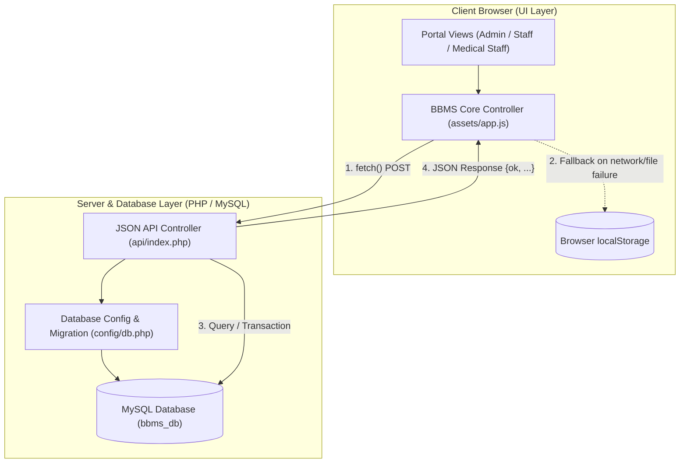
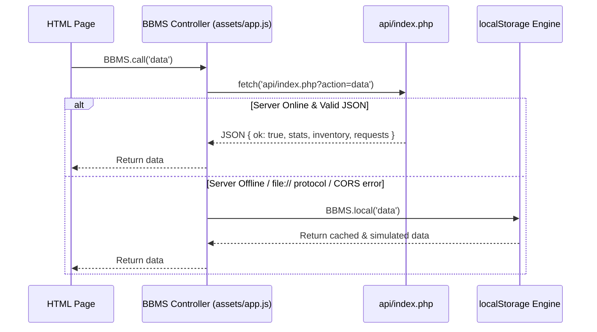

# Blood Bank Management System (BBMS)
## Technical Documentation: JavaScript & PHP Architecture

> [!NOTE]
> This document provides an in-depth breakdown of all JavaScript and PHP source code powering the **Blood Bank Management System (BBMS)**. It details the hybrid client-server architecture, database auto-initialization, dual-mode execution (PHP/MySQL backend + offline `localStorage` simulation), API routing, state management, and role-based security.

---

### Table of Contents
1. [System Architecture Overview](#1-system-architecture-overview)
2. [Database Layer: `config/db.php`](#2-database-layer-configdbphp)
3. [Backend API Controller: `api/index.php`](#3-backend-api-controller-apiindexphp)
4. [Frontend Core Controller: `assets/app.js`](#4-frontend-core-controller-assetsappjs)
5. [Page-Level JavaScript & Component Integration](#5-page-level-javascript--component-integration)
6. [Security & Validation Patterns](#6-security--validation-patterns)
7. [API Action Reference Table](#7-api-action-reference-table)

---

## 1. System Architecture Overview

BBMS is engineered with a **hybrid architectural model**:
- **Full-Stack Mode**: When hosted on an Apache/PHP/MySQL stack (e.g., XAMPP, LAMP, or production server), requests flow through [`api/index.php`](file:///c:/Users/Akshat/Documents/software%20lab%20project/Blood%20Bank%20Management%20System/Blood-Bank-management-system/api/index.php) and persist to `bbms_db` via [`config/db.php`](file:///c:/Users/Akshat/Documents/software%20lab%20project/Blood%20Bank%20Management%20System/Blood-Bank-management-system/config/db.php).
- **Standalone / Demo Mode**: If accessed directly via `file://` protocol or without an active database server, [`assets/app.js`](file:///c:/Users/Akshat/Documents/software%20lab%20project/Blood%20Bank%20Management%20System/Blood-Bank-management-system/assets/app.js) automatically catches the fetch error and switches to an in-browser `localStorage` simulation engine (`this.local()`), ensuring 100% functionality without setup barriers.



---

## 2. Database Layer: `config/db.php`

The database configuration file ([`config/db.php`](file:///c:/Users/Akshat/Documents/software%20lab%20project/Blood%20Bank%20Management%20System/Blood-Bank-management-system/config/db.php)) performs zero-configuration auto-provisioning and schema self-healing on boot.

### Key Responsibilities:
1. **Connection & Error Trapping**:
   Connects to MySQL via `@new mysqli('localhost', 'root', '')`. If connection fails, returns HTTP 500 with JSON error description.
2. **Auto-Database Creation**:
   Executes `CREATE DATABASE IF NOT EXISTS bbms_db CHARACTER SET utf8mb4 COLLATE utf8mb4_unicode_ci` and selects it.
3. **Table DDL & Schema Management**:
   - `users`: Stores login credentials (`user_id`, `username`, `password`, `role`, `created_at`).
   - `donors`: Stores registered blood donors (`donor_id`, `donor_card_no`, `name`, `blood_group`, `contact`, `created_at`).
   - `inventory`: Aggregate blood stock per group (`blood_group` PK, `units_available`).
   - `blood_requests`: Requisitions created by medical staff (`request_id`, `requested_by`, `blood_group`, `units_requested`, `status`, `request_date`).
4. **Schema Evolution (Migration)**:
   Runs `ALTER TABLE blood_requests MODIFY COLUMN status ENUM('Pending', 'Accepted', 'Rejected', 'Cancelled')` to ensure older database installations gain support for cancellation without manual SQL scripts.
5. **Data Seeding & Password Security**:
   - Seeds initial inventory across 8 blood groups (`A+`, `A-`, `B+`, `B-`, `AB+`, `AB-`, `O+`, `O-`) if the table is empty.
   - Automatically provisions/repairs default accounts using **BCrypt** (`PASSWORD_DEFAULT`):
     - `admin` / `admin123` (Admin)
     - `labstaff` / `staff123` (Staff)
     - `doctor` / `doctor123` (Medical Staff)

```php
// Password hashing and repair snippet in config/db.php
foreach ([['admin', 'admin123', 'Admin'], ['labstaff', 'staff123', 'Staff'], ['doctor', 'doctor123', 'Medical Staff']] as $u) {
    $st = $conn->prepare("SELECT user_id, password FROM users WHERE username = ? LIMIT 1");
    $st->bind_param("s", $u[0]);
    $st->execute();
    if ($row = $st->get_result()->fetch_assoc()) {
        if ($row['password'] === $u[1] || strlen($row['password']) < 40) {
            $h = password_hash($u[1], PASSWORD_DEFAULT);
            $up = $conn->prepare("UPDATE users SET password = ?, role = ? WHERE user_id = ?");
            $up->bind_param("ssi", $h, $u[2], $row['user_id']);
            $up->execute();
        }
    } else {
        $h = password_hash($u[1], PASSWORD_DEFAULT);
        $in = $conn->prepare("INSERT INTO users (username, password, role) VALUES (?, ?, ?)");
        $in->bind_param("sss", $u[0], $h, $u[2]);
        $in->execute();
    }
}
```

---

## 3. Backend API Controller: `api/index.php`

[`api/index.php`](file:///c:/Users/Akshat/Documents/software%20lab%20project/Blood%20Bank%20Management%20System/Blood-Bank-management-system/api/index.php) acts as the centralized REST-like dispatch router. It handles request authentication, JSON decoding, parameterized SQL queries, transactions, and unified JSON responses.

### Architectural Features:

#### A. Unified Response & Access Control Helpers
- `respond($data, $code = 200)`: Sets HTTP status header, outputs UTF-8 JSON, and halts execution cleanly with `exit()`.
- `require_auth($roles = [])`: Inspects `$_SESSION['user_id']`. If missing, returns HTTP 401 with `unauthorized: true`. If `$roles` is passed and current user role does not match, returns HTTP 403 `Access denied`.

#### B. API Routing Dispatcher
Incoming action is resolved from `$_GET['action']` or `$input['action']` (decoded from `php://input`).

| Action | HTTP / Input | Auth Required | Description |
| :--- | :--- | :--- | :--- |
| `session` | GET / POST | None | Returns active user session data or `logged_in: false`. |
| `login` | POST (`username`, `password`) | None | Authenticates with `password_verify()`, regenerates session ID, and returns dashboard redirect URL. |
| `logout` | POST | Logged In | Cleans `$_SESSION` and destroys session. |
| `data` | POST | Logged In | Aggregates stats, blood stock levels, donors list, users list (if Admin), and scoped request requisitions. |
| `add_user` | POST (`username`, `password`, `role`) | **Admin** | Hashes password, verifies role validity, inserts new system account. |
| `delete_user` | POST (`user_id`) | **Admin** | Prevents self-deletion, removes account. |
| `handle_request` | POST (`request_id`, `decision`) | **Admin**, **Staff** | Runs MySQL transaction: verifies inventory stock, deducts units, marks request `Accepted` or `Rejected`. |
| `register_donor` | POST (`name`, `blood_group`, `contact`) | **Admin**, **Staff** | Validates contact regex (`/^[0-9]{10}$/`), generates random `DONOR-XXXXX` card number, and inserts record. |
| `lookup_donor` | POST / GET (`donor_card_no`) | **Admin**, **Staff** | Searches donor registry by card number. |
| `confirm_donation` | POST (`donor_card_no`, `units`) | **Admin**, **Staff** | Uses `ON DUPLICATE KEY UPDATE` to atomically increment inventory stock for donor's blood group. |
| `request_blood` | POST (`blood_group`, `units_requested`) | **Medical Staff**, **Admin** | Creates a pending blood requisition linked to `$_SESSION['user_id']`. |
| `cancel_request` | POST (`request_id`) | **Medical Staff**, **Admin** | Validates requisition ownership (doctors only cancel their own) and pending state, then sets status to `Cancelled`. |

#### C. Database Transaction Handling (Blood Dispatch)
To prevent race conditions where multiple staff members approve requests simultaneously beyond available stock, `handle_request` uses a database transaction:

```php
$conn->begin_transaction();
$u1 = $conn->prepare("UPDATE inventory SET units_available = units_available - ? WHERE blood_group = ? AND units_available >= ?");
$u1->bind_param("isi", $units, $bg, $units);
$u1->execute();

$u2 = $conn->prepare("UPDATE blood_requests SET status = 'Accepted' WHERE request_id = ?");
$u2->bind_param("i", $req_id);
$u2->execute();
$conn->commit();
```

---

## 4. Frontend Core Controller: `assets/app.js`

[`assets/app.js`](file:///c:/Users/Akshat/Documents/software%20lab%20project/Blood%20Bank%20Management%20System/Blood-Bank-management-system/assets/app.js) is the central client-side orchestrator. It manages UI themes, toasts, modals, data fetching, offline persistence, and path resolution.

### Core Modules:

### 1. Global Utilities & Helpers
- `esc(s)`: Sanitizes strings to escape `&`, `<`, `>`, `"`, and `'` to protect against Cross-Site Scripting (XSS).
- `formatDate(d)`: Parses SQL timestamp formats and outputs human-friendly localized dates (e.g., `Oct 14, 2026 · 02:45 PM`).

### 2. Dark / Light Theme Controller
- Checks `localStorage` key `bbms_theme` (with fallback to `ibbms_theme`).
- Applies `data-theme="dark"` or `data-theme="light"` to the `<html>` root element.
- `toggleTheme()`: Flips theme attribute and dynamically swaps SVG sun/moon icons on all `.theme-btn` elements.

### 3. Toast Notifications & Confirmation Modals
- `showAlert(msg, type)`: Spawns animated floating notification banners (`toast-success`, `toast-error`, `toast-info`) in `.toast-container` with auto-dismiss after 4 seconds.
- `confirmModal({ title, message, confirmText, confirmClass, onConfirm })`: Reusable async modal dialog that traps user confirmation before destructive actions (deleting users, rejecting requests, approving stock dispatches).

### 4. `BBMS` Controller & Client Router



#### A. Intelligent Path Resolver
Because portal pages reside in subdirectories (`admin/`, `staff/`, `medical_staff/`) while `index.html` sits at root:
- `apiPath()`: Checks `location.pathname`. If in a subdirectory, routes to `../api/index.php`; otherwise routes to `api/index.php`.
- `rootPrefix()`: Returns `'../'` when inside subdirectories, ensuring asset and redirect paths never break regardless of nesting depth.

#### B. Storage Auto-Healing & Migration (`seedStore`)
`seedStore()` ensures that if an end user visits with partial or older `localStorage` structures, all missing arrays (`users`, `inventory`, `donors`, `requests`) are auto-populated from default fixtures without throwing runtime exceptions.

#### C. `BBMS.loadShell(role)`
Called at the top of every dashboard and management view:
1. Calls `BBMS.call('data')`.
2. Verifies authentication; if unauthorized, redirects to `index.html?error=unauthorized`.
3. Auto-populates top navigation bar user identity:
   - `navUsername`: current username (e.g. `admin`, `doctor`).
   - `navRole`: role tag badge.
   - `navAvatar`: two-letter uppercase monogram (e.g. `AD`, `DO`).
4. Returns the fetched dataset for immediate view rendering.

#### D. Backward-Compatibility Aliases
To guarantee total backwards compatibility with legacy HTML calls or browser extensions:
```javascript
const IBBMS = BBMS;
if (typeof window !== 'undefined') {
    window.BBMS = BBMS;
    window.IBBMS = BBMS;
}
```

---

## 5. Page-Level JavaScript & Component Integration

Each frontend view pairs [`assets/app.js`](file:///c:/Users/Akshat/Documents/software%20lab%20project/Blood%20Bank%20Management%20System/Blood-Bank-management-system/assets/app.js) with view-specific rendering functions:

### 1. [`index.html`](file:///c:/Users/Akshat/Documents/software%20lab%20project/Blood%20Bank%20Management%20System/Blood-Bank-management-system/index.html) (Authentication Portal)
- Intercepts form submission via `handleLogin(e)`.
- Disables submit button to prevent double-submissions.
- Calls `BBMS.call('login', { username, password })`.
- On success, redirects to role dashboard (`admin/dashboard.html`, `staff/dashboard.html`, or `medical_staff/dashboard.html`).

### 2. Admin Portal
- [`admin/dashboard.html`](file:///c:/Users/Akshat/Documents/software%20lab%20project/Blood%20Bank%20Management%20System/Blood-Bank-management-system/admin/dashboard.html): Loads summary counters, renders blood inventory grid with critical/low warnings, renders recent 5 requisitions and recent 5 donors.
- [`admin/manage_users.html`](file:///c:/Users/Akshat/Documents/software%20lab%20project/Blood%20Bank%20Management%20System/Blood-Bank-management-system/admin/manage_users.html): Provides account creation with role selection, user listing table, and account deletion with confirmation modal.
- [`admin/manage_requests.html`](file:///c:/Users/Akshat/Documents/software%20lab%20project/Blood%20Bank%20Management%20System/Blood-Bank-management-system/admin/manage_requests.html): Filterable table (All, Pending, Accepted, Rejected, Cancelled) with approval/rejection triggers.
- [`admin/reports.html`](file:///c:/Users/Akshat/Documents/software%20lab%20project/Blood%20Bank%20Management%20System/Blood-Bank-management-system/admin/reports.html): Stock summary analytics and client-side CSV generator (`exportDonorsCSV()`).

### 3. Staff Portal (Blood Bank Laboratory)
- [`staff/dashboard.html`](file:///c:/Users/Akshat/Documents/software%20lab%20project/Blood%20Bank%20Management%20System/Blood-Bank-management-system/staff/dashboard.html): Real-time stock counts and quick action links.
- [`staff/register_donor.html`](file:///c:/Users/Akshat/Documents/software%20lab%20project/Blood%20Bank%20Management%20System/Blood-Bank-management-system/staff/register_donor.html): Donor intake form that generates unique donor cards.
- [`staff/log_donation.html`](file:///c:/Users/Akshat/Documents/software%20lab%20project/Blood%20Bank%20Management%20System/Blood-Bank-management-system/staff/log_donation.html): Two-step donation workflow: verifies donor card ID, previews donor blood group, logs units, and increments inventory.
- [`staff/manage_requests.html`](file:///c:/Users/Akshat/Documents/software%20lab%20project/Blood%20Bank%20Management%20System/Blood-Bank-management-system/staff/manage_requests.html): Requisition fulfillment and stock dispatch.

### 4. Medical Staff Portal (Doctors & Wards)
- [`medical_staff/dashboard.html`](file:///c:/Users/Akshat/Documents/software%20lab%20project/Blood%20Bank%20Management%20System/Blood-Bank-management-system/medical_staff/dashboard.html): Requisition activity stats and pending approvals counter.
- [`medical_staff/request_blood.html`](file:///c:/Users/Akshat/Documents/software%20lab%20project/Blood%20Bank%20Management%20System/Blood-Bank-management-system/medical_staff/request_blood.html): Requisition form enforcing blood group selection and unit constraints (1 to 10 units).
- [`medical_staff/my_requests.html`](file:///c:/Users/Akshat/Documents/software%20lab%20project/Blood%20Bank%20Management%20System/Blood-Bank-management-system/medical_staff/my_requests.html): Chronological table of doctor's own requisitions with interactive **"Cancel"** action on any `Pending` request.

---

## 6. Security & Validation Patterns

| Layer | Defense Mechanism | Implementation Details |
| :--- | :--- | :--- |
| **Authentication** | BCrypt Password Hashing | `password_hash($password, PASSWORD_DEFAULT)` with `password_verify()` in `api/index.php`. |
| **Session Integrity** | Session Fixation Protection | `session_regenerate_id(true)` called upon successful login. |
| **Authorization** | Strict Role-Based Access Control | `require_auth(['Admin', 'Staff'])` checks before privileged actions. |
| **SQL Injection** | Parameterized Prepared Statements | All database queries use `$conn->prepare()` and `$st->bind_param()`. |
| **XSS Prevention** | Entity Escaping | `esc(s)` encodes `& < > " '` before rendering dynamic values into the DOM. |
| **Race Conditions** | Database Transactions | `begin_transaction()` and `commit()` protect inventory stock deduction. |
| **Input Sanitization** | Regex & Type Casting | Phone numbers validated against `/^[0-9]{10}$/`; units cast via `(int)` and bounded with `min/max`. |

---

## 7. API Action Reference Table

| Action Name | Source File | Handler Function | Typical Client Call |
| :--- | :--- | :--- | :--- |
| `session` | `api/index.php` | `action === 'session'` | `BBMS.call('session')` |
| `login` | `api/index.php` | `action === 'login'` | `BBMS.call('login', { username, password })` |
| `logout` | `api/index.php` | `action === 'logout'` | `BBMS.call('logout')` |
| `data` | `api/index.php` | `action === 'data'` | `BBMS.loadShell('Admin')` |
| `add_user` | `api/index.php` | `action === 'add_user'` | `BBMS.call('add_user', { username, password, role })` |
| `delete_user` | `api/index.php` | `action === 'delete_user'` | `BBMS.call('delete_user', { user_id })` |
| `handle_request` | `api/index.php` | `action === 'handle_request'` | `BBMS.call('handle_request', { request_id, decision })` |
| `register_donor` | `api/index.php` | `action === 'register_donor'` | `BBMS.call('register_donor', { name, blood_group, contact })` |
| `lookup_donor` | `api/index.php` | `action === 'lookup_donor'` | `BBMS.call('lookup_donor', { donor_card_no })` |
| `confirm_donation`| `api/index.php` | `action === 'confirm_donation'`| `BBMS.call('confirm_donation', { donor_card_no, units })` |
| `request_blood` | `api/index.php` | `action === 'request_blood'` | `BBMS.call('request_blood', { blood_group, units_requested })` |
| `cancel_request` | `api/index.php` | `action === 'cancel_request'` | `BBMS.call('cancel_request', { request_id })` |
